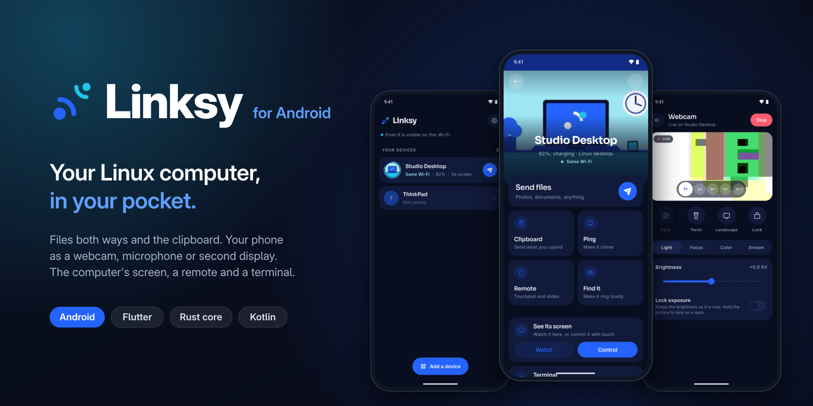

<div align="center">

  <sub>The phone app for <a href="https://github.com/LinkSy-mg/linksy-desktop">Linksy</a>: files, clipboard, screens, webcam, microphone and a remote between your Android phone and your own computers. Directly over the local network, with no account, cloud or server.</sub>
  <br/><br/>

<p align="center">
  <a href="https://github.com/LinkSy-mg/linksy-releases#android">
    </a>
  <a href="https://github.com/LinkSy-mg/linksy-releases/releases">
    </a>
  <a href="https://flutter.dev">
    </a>
  <br/>
  <a href="https://github.com/LinkSy-mg/linksy-mobile/stargazers">
    </a>
  <a href="https://github.com/LinkSy-mg/linksy-mobile/issues">
    </a>
  <a href="https://linksy.diary.mg">
    </a>
</p>

**[Install](#install)** &nbsp;·&nbsp; **[What it does](#what-it-does)** &nbsp;·&nbsp; **[For developers](#for-developers)** &nbsp;·&nbsp; **[The Rust bridge](#the-rust-bridge)** &nbsp;·&nbsp; **[Linux app](https://github.com/LinkSy-mg/linksy-desktop)**

</div>

> [!NOTE]
> This is the source of the Android app. To install it, get the APK from [linksy-releases](https://github.com/LinkSy-mg/linksy-releases#android). The product, the wire protocol and the feature status are in [`docs/protocol.md`](https://github.com/LinkSy-mg/linksy-desktop/blob/main/docs/protocol.md) in linksy-desktop: read it before changing anything that talks to other devices.

---

## Install

1. On the phone, open [linksy-releases](https://github.com/LinkSy-mg/linksy-releases#android) and download **Linksy for every phone**.
2. Open the file, allow installing from your browser once, and install.
3. Install Linksy on your computer too, open it on both, and pair once: both screens show the same code.

To update, install a newer APK the same way.

---

## What it does

- **Discovery and pairing:** QR scanner, `linksy://pair` links, address or 6-digit code,
  presence, **away from home** over iroh and Linksy's relay, the **USB cable** (AOA bridge).
- **Files** both ways (Accept/Decline also in the notification, Downloads/Linksy), the share
  sheet, clipboard text and **files**, clipboard watch from computers, ping, open links.
- **Everyday:** battery, ring both ways, the computer's players, calls pause music, lock
  when away (heartbeats), photo backup, the Files sidebar on a picked folder.
- **Sessions:** screen sharing, **webcam** (full controls, 720p/1080p, 30/60 fps, controls
  from the computer), **microphone**, second display in the phone's shape, watching and
  controlling the computer's screen, touchpad/keyboard/slides.
- **And more:** device pictures both ways, locate (opt-in), service notices, push news.
- **10 languages** (English, French, Malagasy, Spanish, Portuguese, German, Italian,
  Russian, Chinese, Japanese), first-run setup, light/dark/system appearance.

Not possible in a sideloaded app (see [`docs/android-app.md`](docs/android-app.md) §3): texting, mirroring
the phone's notifications or its media, remote control of the phone, watching its
clipboard, background location.

---

## For developers

### Status

The app runs on **linksy-core itself** (Rust, from linksy-desktop) through
flutter_rust_bridge, so it speaks the desktop's exact protocol. Tested against a node on
the same network: pairing by invite link and by 6-digit code, files both ways (resume
and BLAKE3 checks are the core's), clipboard and pings both ways, and screen, camera,
remote control and second-display sessions (streams checked for profile, SPS/PPS before
keyframes, size, frame rate and rotation; input checked both ways).

Up to date with desktop 0.6.0 (core `1c8ebe4`). Translations use gen-l10n:
`lib/l10n/app_*.arb`, Android's own text in `android/app/src/main/res/values-*`.

### For the desktop side

[`docs/android-app.md`](docs/android-app.md) tells linksy-desktop what the phone does, what it needs from the
desktop, and which features Android won't allow in a sideloaded app.

### Lean on purpose

What ships is only what runs. Dependencies are Flutter and `flutter_rust_bridge`, plus
ZXing core (Java, offline) for reading QR codes and Firebase Cloud Messaging for push
(wired natively in `Push.kt`, analytics off; config in `android/app/google-services.json`,
project `linksy-mg`; every install joins the `all` topic, so the console can send news). Everything else is the platform's own:
Android's document picker for sending, a read-only `ReceivedFiles` provider for opening
received files, Camera2 for the scanner and sharing, and folder paths over the
platform channel. No ML Kit, analytics or storage permissions; folders come from
Android's folder picker.

The APK declares: network and Wi-Fi multicast, camera, microphone (asked only when a
computer wants it), location while in use (asked only when "Let computers locate this
phone" is turned on), notifications, vibration, push (`c2dm.permission.RECEIVE`), and
foreground services for screen capture, camera and microphone (only while sharing) and
for staying connected (lock when away, opt-in background). No SMS, notification-listener,
accessibility, background-location or storage permissions. Check a build with
`aapt2 dump permissions <apk>` before releasing.

The Rust library is built for size (`opt-level = "z"`, fat LTO) except the hot paths,
QUIC, TLS and BLAKE3, which stay at `opt-level = 3`.

---

## The Rust bridge

Per `docs/protocol.md` §3 the protocol is **not** reimplemented in Dart (QUIC, mutual TLS with
self-signed certificates, the TLS exporter behind the pairing code). Instead:

- `rust/` is a thin crate over `linksy_core::Node` (a git dependency pinned to a
  linksy-desktop commit). Values cross as JSON in the core's own serde shapes; errors as
  kinds (`unreachable`, `declined`…) that `lib/core/rust_node.dart` words with the
  device's name.
- `lib/src/rust/` and `rust/src/frb_generated.rs` are generated by
  `flutter_rust_bridge_codegen generate` (committed, so Dart builds without Rust).
- `lib/core/rust_node.dart` implements the app's `LinksyNode` on the bindings.
- `MainActivity.kt` holds a `WifiManager.MulticastLock` from `onStart` to `onStop`,
  gives Dart the phone's name, forwards `linksy://pair` links, and asks for screen
  capture and camera consent.
- Screen and camera sharing (`android/…/media/`): `ShareService` (foreground, types
  `mediaProjection|camera`) feeds MediaProjection or Camera2 into a hardware H.264
  encoder (Constrained Baseline, Annex-B, keyframe every 2 s, SPS/PPS before each,
  screen at its exact shape within 1920×1080 at ≤ 30 fps, restarted on rotation; camera
  1280×720 at 30 fps). Video and input cross through JNI (`rust/src/sessions.rs`, one
  task per session owning its streams), not through Dart.
- Second display: `DisplayReceiver` decodes the desktop's stream into a Flutter texture
  (`TextureRegistry.SurfaceProducer`); `DisplayScreen` sends touches back as framed
  `pointer`/`button`/`scroll` messages.

### Build

Build the native libraries before `flutter run` or a release (release.sh does it):

```sh
tool/build_rust.sh
```

It needs `rustup` (Homebrew's keg: `/opt/homebrew/opt/rustup/bin`), the targets
`aarch64-linux-android armv7-linux-androideabi x86_64-linux-android`, `cargo-ndk`,
`flutter_rust_bridge_codegen` 2.13.0, NDK 28.2 and SSH access to linksy-desktop. To move
to a newer core, change the `rev` in `rust/Cargo.toml` and rebuild.

Core logs go to logcat under the tag `linksy`.
